# V3 用户视觉终审记录

- 任务：`V3` / v1.2 第四波 UI-REMAKE 用户视觉终审
- 创建时间：2026-07-05 16:00:18 CST
- 执行者职责：准备环境、说明终审项、记录用户结论；不替用户做主观判断。
- 当前状态：用户视觉终审不通过，待规划者裁定是否重开 scoped-fix
- 证据汇总：`coordination/reports/V3-summary.json`
- 截图总数：47 张（4 横屏 x 11 captures + 3 张设置持久化附图）
- 实机手感入口：`http://127.0.0.1:18080/`
- 构建日志：`/tmp/doudizhu-v3-user-review-cocos-build.log`

## 终审项

请用户逐项给出「通过 / 不通过 + 具体反馈」。任一项不通过，则转规划者裁定是否重开 scoped-fix。

| 项目 | 用户结论 | 具体反馈 |
|---|---|---|
| pink 整体观感 | 不通过 | 大量的元素显示异常和重叠；不允许出现文字盖在文字上的情况；同时如果 btn 上带文字，btn 的背景必须包裹文字；同时 btn 的颜色和文字的颜色需要形成反差对比；头部底牌区域的三张牌会出现闪烁，严重 bug。 |
| 人物与牌桌关系 | 不通过 | 左上和右上的角色需要分别左移和右移，整体向上移动。 |
| 名字牌对比度 | 不通过 | 元素之间不可重叠。 |
| 手牌可读性 | 不通过 | 手牌元素中间不要再出现数字。 |
| 按钮易点性 | 不通过 | 如果 btn 上带文字，btn 的背景必须包裹文字；同时 btn 的颜色和文字的颜色需要形成反差对比。 |
| 结算观感 | 不通过 | 用户未补充具体反馈。 |
| 整体手感（实机） | 不通过 | 视觉元素之间不可重叠。 |

## 建议审查顺序

1. 先看 `844x390` 全链路，确认主设计效果。
2. 再看 `812x375`、`915x412`、`780x360`，确认横屏适配和元素不挤压。
3. 最后看设置持久化 3 张附图；整体手感请打开 `http://127.0.0.1:18080/` 实玩确认。

## 截图分组

### 844x390

- 大厅：
- 叫抢：
- 出牌开始：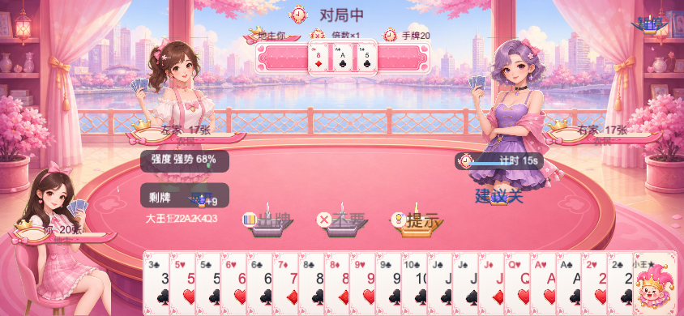
- 玩家选牌：
- 玩家出牌：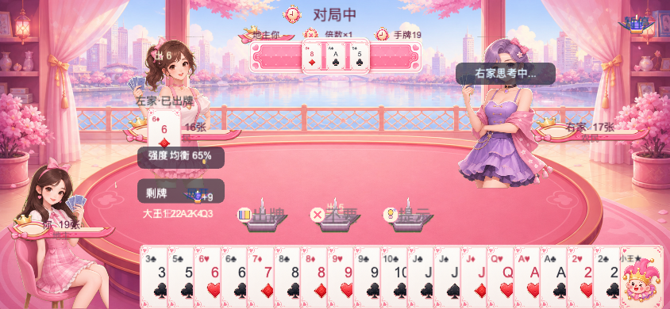
- AI 出牌：
- 第一局结算：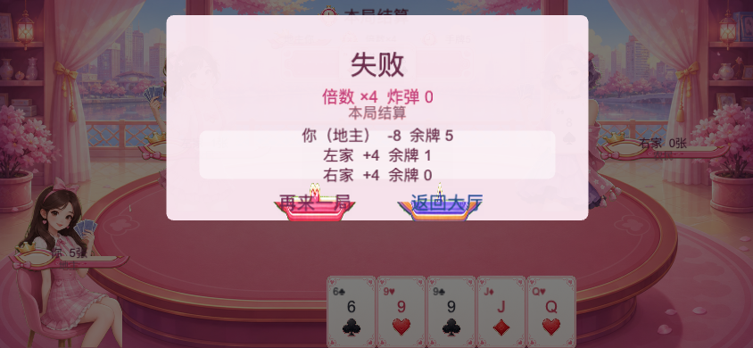
- 再来一局后叫抢：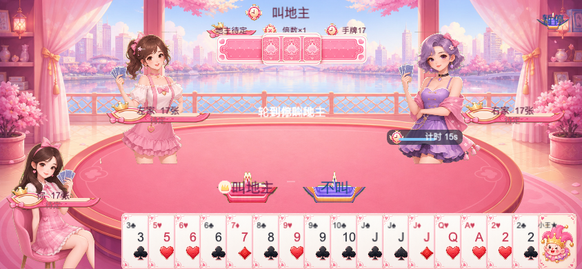
- 第二局叫抢：
- 第二局结算：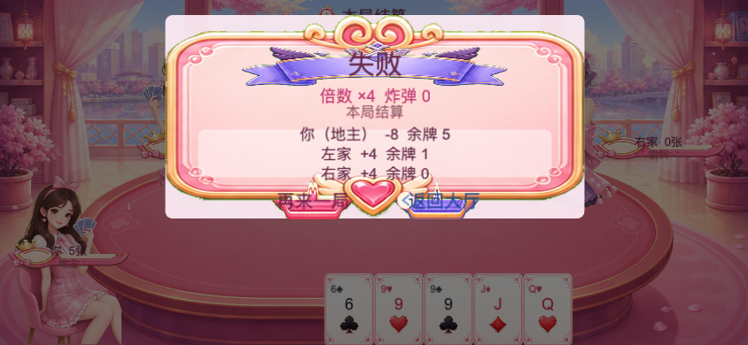
- 返回大厅：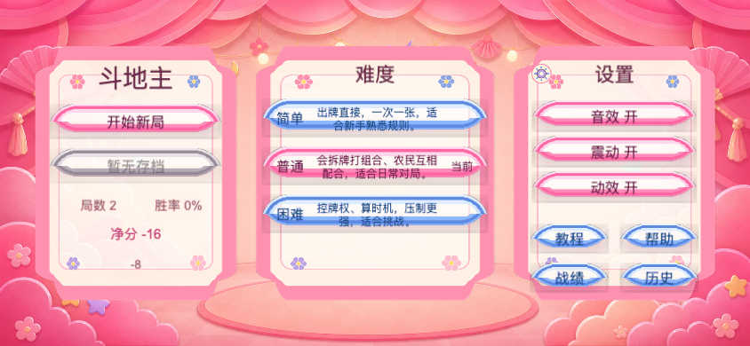

### 812x375

- 大厅：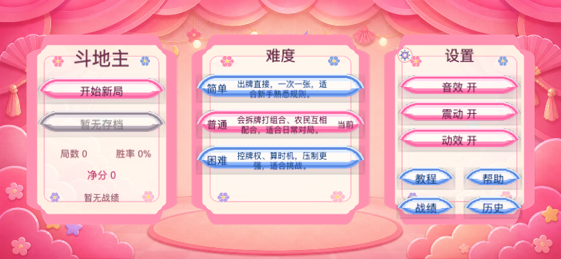
- 叫抢：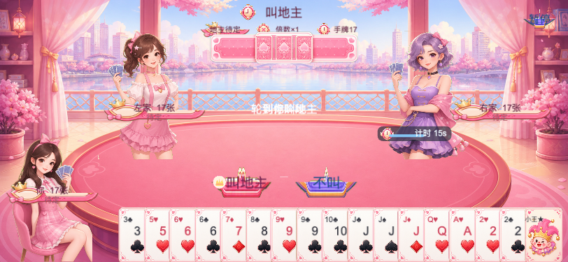
- 出牌开始：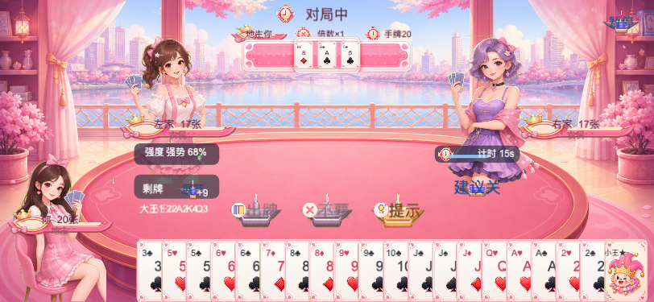
- 玩家选牌：
- 玩家出牌：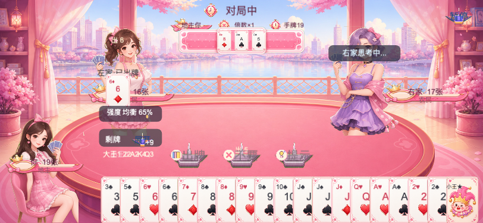
- AI 出牌：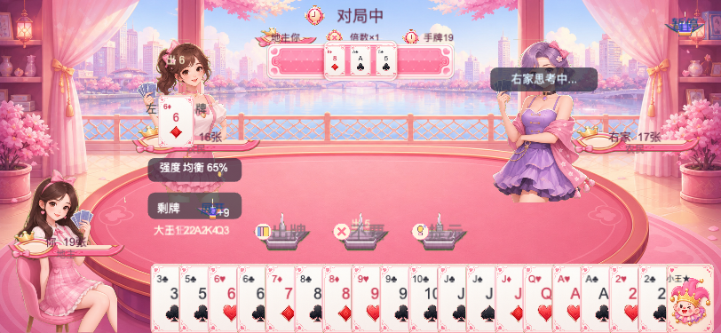
- 第一局结算：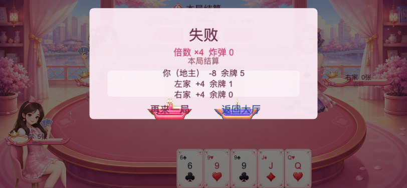
- 再来一局后叫抢：
- 第二局叫抢：
- 第二局结算：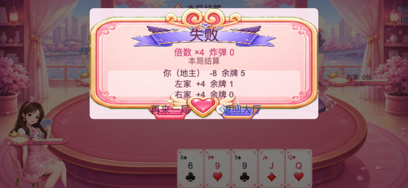
- 返回大厅：

### 915x412

- 大厅：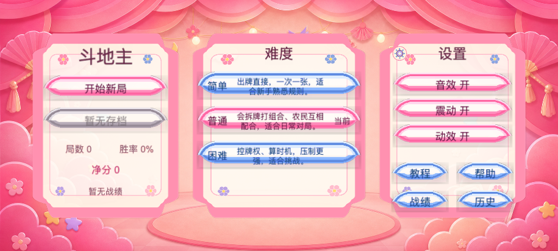
- 叫抢：
- 出牌开始：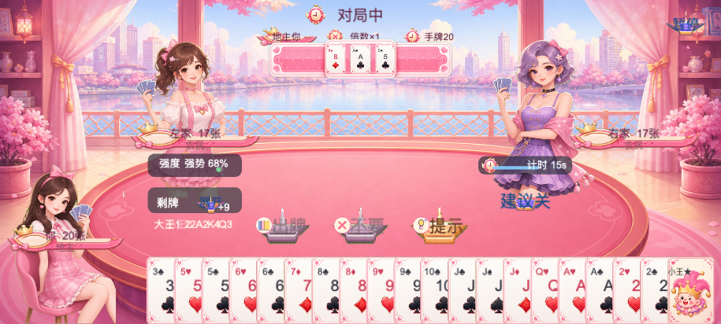
- 玩家选牌：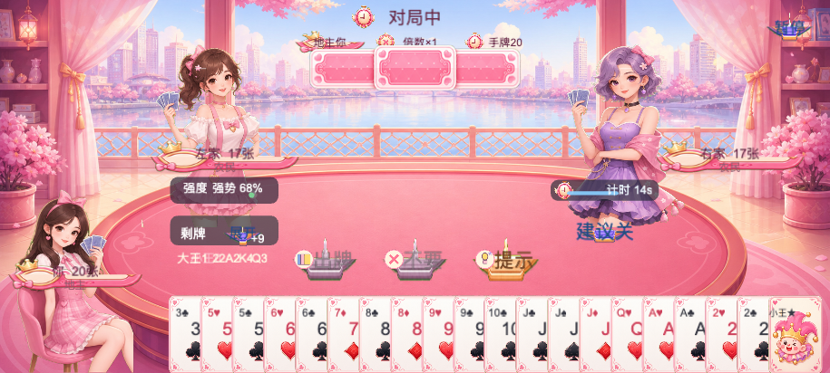
- 玩家出牌：
- AI 出牌：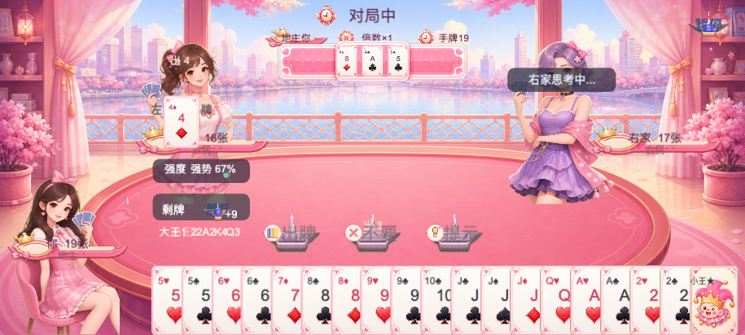
- 第一局结算：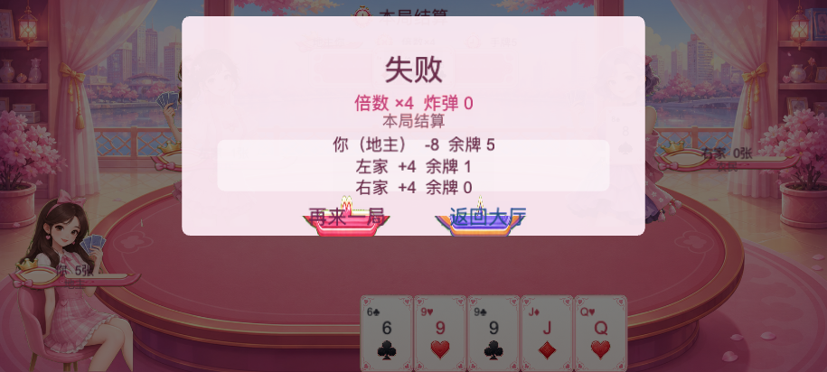
- 再来一局后叫抢：
- 第二局叫抢：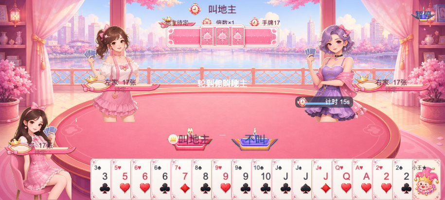
- 第二局结算：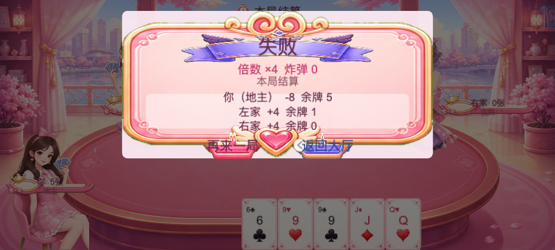
- 返回大厅：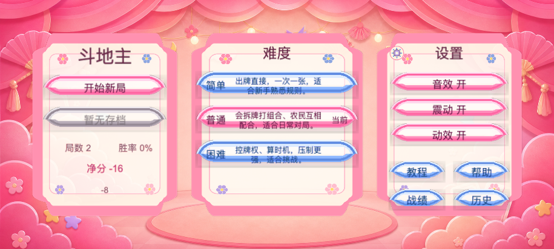

### 780x360

- 大厅：
- 叫抢：
- 出牌开始：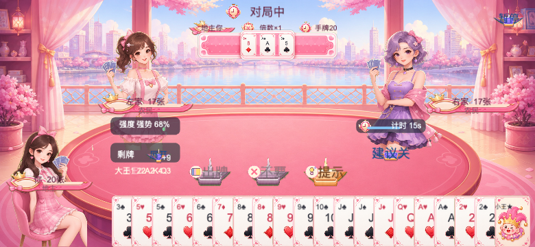
- 玩家选牌：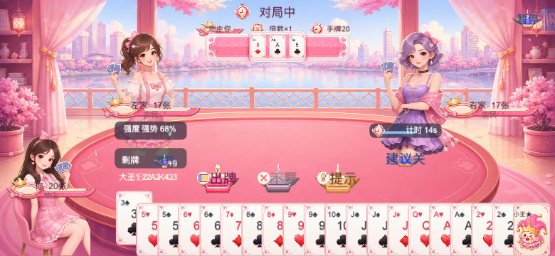
- 玩家出牌：
- AI 出牌：
- 第一局结算：
- 再来一局后叫抢：
- 第二局叫抢：
- 第二局结算：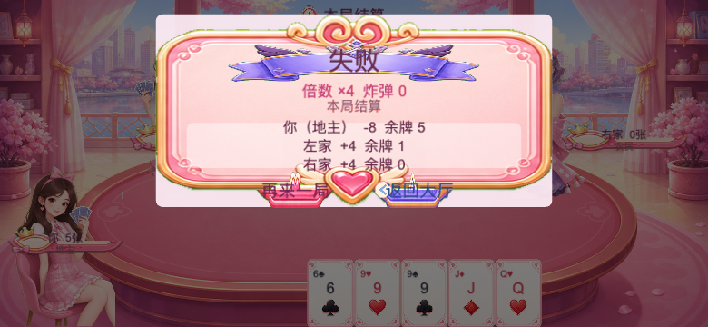
- 返回大厅：

### 设置持久化附图

- 暂停设置：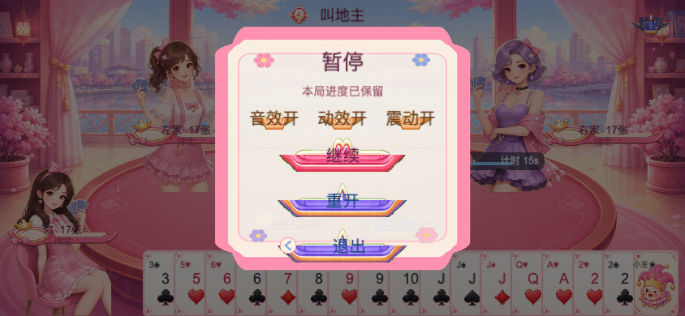
- 切换后：
- 刷新回大厅：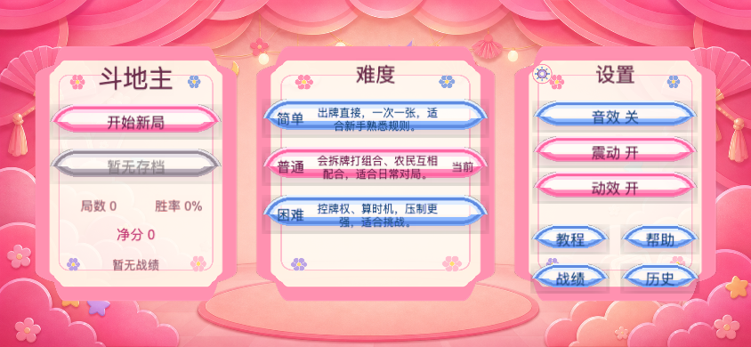

## 用户视觉终审记录

- 记录时间：2026-07-05 16:13:33 CST
- 用户结论：7 项均不通过；v1.2 终局条件未满足，需交规划者裁定是否重开 scoped-fix。
- 证据路径：本文件「截图分组」所列 47 张截图；实机入口 `http://127.0.0.1:18080/`。

用户原文反馈：

```text
pink 整体观感：不通过，反馈：大量的元素显示异常和重叠；不允许出现文字盖在文字上的情况；同时如果btn上带文字，btn的背景必须包裹文字；同时btn的颜色和文字的颜色需要形成反差对比；头部底牌区域的三张牌会出现闪烁，严重bug；
人物与牌桌关系：不通过，反馈：左上和右上的角色需要分别左移和右移，整体向上移动；
名字牌对比度：不通过，反馈：元素之间不可重叠；
手牌可读性：不通过，反馈：手牌元素中间不要再出现数字了；
按钮易点性：不通过，反馈：如果btn上带文字，btn的背景必须包裹文字；同时btn的颜色和文字的颜色需要形成反差对比；
结算观感：不通过，反馈：
整体手感：不通过，反馈：反馈：视觉元素之间不可重叠；
```

执行者整理的问题方向（仅归类，不替用户裁定）：

- 文本与元素重叠：文字盖文字、元素互相重叠、名字牌/视觉元素不可重叠。
- 按钮可读与包裹：有文字的按钮背景必须完整包裹文字，按钮底色与文字颜色需要明显反差。
- 底牌显示：头部底牌区域三张牌闪烁，用户判定为严重 bug。
- 人物布局：左上角色继续左移，右上角色继续右移，三名角色整体上移。
- 手牌：手牌元素中间不要再出现数字。
- 结算：用户结论不通过，暂无额外具体说明。

## 后续交接

- 若 7 项均通过：执行者记录后，交规划者做 v1.2 版本终局裁定。
- 若任一项不通过：执行者记录具体反馈后，交规划者裁定是否重开 scoped-fix。
